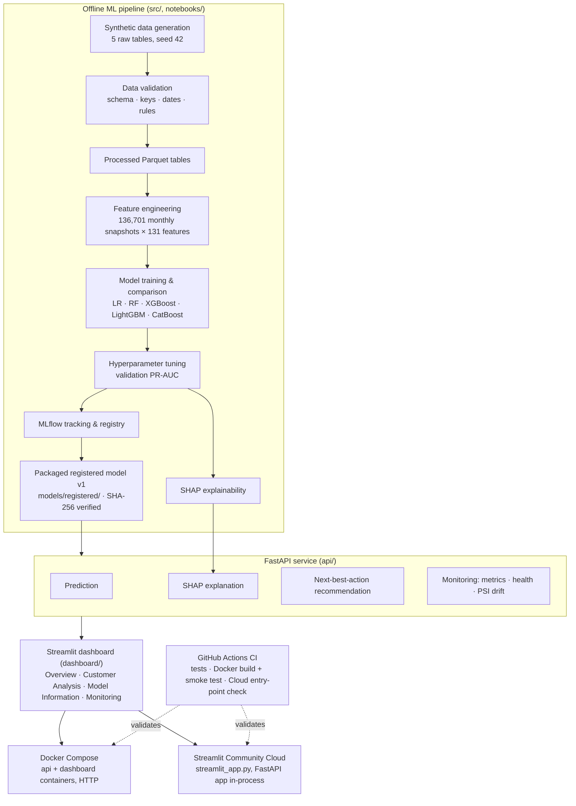

# Customer Retention Intelligence Platform

An end-to-end machine learning platform for customer churn prediction, SHAP explainability,
next-best-action retention recommendations, API serving, monitoring, and interactive
visualization — built on synthetic customer data.

🚀 **Live Demo:** [Open Customer Retention Intelligence](https://customer-retention-intelligencee.streamlit.app/)

[](https://github.com/mandaldhananjay248-beep/customer-retention-intelligence/actions/workflows/ci.yml)


---

## Overview

The platform predicts which customers are likely to churn in the next 30 days, explains
*why* each prediction was made, and turns the prediction into a concrete, prioritized
retention action. It covers the full ML lifecycle:

- **Data:** seeded synthetic data generation, schema and business-rule validation, and
  leakage-safe feature engineering over monthly customer snapshots.
- **Modeling:** a chronological train/validation/test split, five model families
  compared and tuned on PR-AUC, and a regularized Logistic Regression selected.
- **Explainability and decisions:** per-customer SHAP drivers, plus a configurable
  next-best-action rule engine.
- **MLOps:** MLflow tracking and a model registry, a FastAPI inference service,
  in-process monitoring with PSI-based drift detection, Docker Compose, GitHub Actions
  CI, and a public Streamlit dashboard on Streamlit Community Cloud.

It was built as a portfolio project to show how a churn model goes from raw data to a
monitored, tested, deployed decision-support tool — with honest evaluation on a hard,
heavily imbalanced problem.

## Business Problem

Subscription businesses lose revenue when customers leave, and winning a customer back
is usually harder than keeping one. A retention team with limited capacity needs to know:

- **Who** is likely to churn soon (here: within the next 30 days).
- **Why** the model considers them at risk, so outreach addresses the actual problem.
- **Whom to contact first**, when not every at-risk customer can be contacted.
- **What to do** — payment help, a support follow-up, a re-engagement campaign, or nothing.

This project frames churn as a binary prediction on monthly customer snapshots and
combines it with explanations and rule-based recommendations. The data is synthetic, so
no real financial impact is claimed.

## Project Objectives

- Generate reproducible synthetic data for customers, transactions, product usage,
  support tickets and churn events.
- Validate every dataset: schema, types, foreign keys, dates and business rules.
- Build a **leakage-safe** feature set: features use only data on or before each
  snapshot date.
- Compare Logistic Regression, Random Forest, XGBoost, LightGBM and CatBoost on a
  chronological split, with class-imbalance handling and PR-AUC as the primary metric.
- Tune hyperparameters on validation only; touch the test split once, for reporting.
- Explain predictions globally and per customer with SHAP.
- Convert predictions into risk levels, priorities and next-best actions.
- Track and register the model with MLflow.
- Serve predictions, explanations and recommendations through FastAPI.
- Monitor requests, predictions, data drift and prediction drift.
- Provide a Streamlit dashboard, Docker Compose setup, CI pipeline and public deployment.

## Solution Architecture



The same FastAPI application serves the dashboard in both runtime modes:

| Mode | How the dashboard reaches the API | Entry point |
|---|---|---|
| Local / Docker Compose | HTTP to a separate FastAPI process or container (`API_BASE_URL`) | `dashboard/app.py` |
| Streamlit Community Cloud | Same requests sent in-process to the same `api.main:app` (`DASHBOARD_API_MODE=inprocess`) | `streamlit_app.py` |

In both modes the dashboard never loads the model or computes predictions itself; FastAPI
is the single source of truth for inference, explanations and recommendations.

## Data Sources

All data is **synthetic**, produced by `src/data/generate_data.py` with a fixed random
seed (`configs/data_config.yaml`: seed 42, 10,000 customers, 2024-01-01 to 2026-06-30,
3% injected missing values).

| Dataset | Rows | Key columns |
|---|---:|---|
| `customers.csv` | 10,000 | `customer_id`, `signup_date`, `age`, `country`, `plan`, `contract_type`, `acquisition_channel` |
| `transactions.csv` | 299,921 | `transaction_date`, `transaction_type`, `amount`, `payment_method`, `payment_status` |
| `usage.csv` | 1,246,888 | `usage_date`, `login_count`, `session_minutes`, `feature_usage_count`, `pages_viewed`, `active_minutes` |
| `support_tickets.csv` | 85,577 | `created_date`, `category`, `priority`, `resolution_time_hours`, `satisfaction_score`, `ticket_status` |
| `churn_events.csv` | 1,929 | `customer_id`, `churn_date`, `churn_reason` |

**How churn is generated:** each customer's transaction, usage and support history is
combined into a noisy risk score, converted to a churn probability, and churn is
*sampled* from that probability (not a deterministic rule). Churn dates are sampled
within each customer's lifecycle.

**Target:** `churn_next_30_days = 1` if `snapshot_date < churn_date <= snapshot_date + 30 days`,
else `0`.

> Because churn generation uses each customer's full behavioral history, the synthetic
> labels may encode relationships that a real dataset would not. The feature pipeline is
> leakage-safe on its own terms, but model performance should be read as a methodology
> demonstration.

## Data Pipeline

```text
data/raw/*.csv ─► validation ─► data/processed/*.parquet ─► feature engineering ─► customer_features.parquet
 (generate_data)  (validate_data)     (load_data)            (feature_engineering)    (model-ready)
```

**Validation safeguards** (`src/data/validate_data.py`). These count and report problems;
they never modify records:

- Required columns and data types for every table.
- Foreign keys: every `customer_id` in an event table exists in `customers`.
- Dates: no event before the customer's signup date or after the dataset's end date.
- Value rules: non-negative amounts, usage metrics and resolution times; valid ranges for
  age and satisfaction.
- Categories: plans, contract types, channels, transaction types, payment methods and
  statuses, ticket categories and priorities must be from the expected sets.

**Feature-dataset checks** (`src/features/feature_engineering.py`):

- No snapshot earlier than the customer's signup.
- No duplicate `(customer_id, snapshot_date)` rows.
- Target correctness.
- A **non-tautological leakage audit**: recency features are recomputed directly from
  the raw tables, filtered to data on or before each snapshot, and compared with the
  pipeline's output.

**Reproducibility:** the processed dataset is not committed.
`python -m src.data.regenerate_feature_dataset` re-runs the seeded pipeline and fails
unless the result matches a stored content fingerprint of the dataset the model was
registered with.

## Exploratory Data Analysis

Exploration in this project lives in the phase notebooks, not in a standalone EDA
notebook. `02_eda.ipynb` and `03_statistical_analysis.ipynb` are placeholder notebooks
with no analysis yet. The exploratory work that does exist:

- **`01_data_ingestion.ipynb`** — per-table profiling (shape, sample rows, `info()`,
  missing-value counts and percentages, `describe()` summaries), followed by
  relationship, date and business-rule validation.
- **`04_feature_engineering.ipynb`** — snapshot definition, feature dataset inspection,
  target construction and leakage validation.
- **`05_baseline_model.ipynb`** — target and class distribution across the
  chronological splits.
- **`09_next_best_action.ipynb`** — the percentile analysis of engagement, usage-trend,
  support and payment features that sets the business thresholds, plus distributions of
  risk levels, actions and priorities.

**Key observation — severe class imbalance:** only **1.22%** of the 136,701 snapshots
are positive (1,670 churn-within-30-days labels). This drives the choice of PR-AUC as
the primary metric and class weighting in every model.

## Feature Engineering

Features are built for **17 monthly snapshots** (2025-01-31 to 2026-05-31). A customer
is eligible at a snapshot only if they had already signed up and had not yet churned.
Every feature uses only data **on or before** the snapshot date.

The result is **136,701 rows × 131 model features** (127 numeric, 4 categorical).

| Group | Features (examples of actual column names) |
|---|---|
| Customer profile | `age`, `country`, `plan`, `contract_type`, `acquisition_channel`, `tenure_days`, `tenure_months` |
| Transactions / RFM (30, 60, 90, 180-day windows) | `txn_count_{w}d`, `txn_amount_sum/mean/max_{w}d`, `txn_success/failed_count_{w}d`, `txn_purchase/renewal/upgrade_count_{w}d`, `txn_failed_rate_{w}d` |
| Transaction recency | `days_since_last_transaction`, `days_since_last_successful_transaction`, `has_any_transaction_history` |
| Usage (recent 30d, previous 30d, 90d) | `active_days_*`, `avg_login_count_*`, `avg_session_minutes_*`, `avg_feature_usage_count_*`, `avg_pages_viewed_*`, `avg_active_minutes_*`, `usage_missing_rate_*` |
| Usage trends | `login_count_change_30d`, `session_minutes_pct_change_30d`, `feature_usage_count_pct_change_30d`, `active_minutes_pct_change_30d`, … |
| Usage recency | `days_since_last_usage`, `has_any_usage_history` |
| Support (30, 90, 180-day windows) | `ticket_count_{w}d`, `pending/resolved/closed_ticket_count_{w}d`, `high_critical_ticket_count_{w}d`, `avg/min_satisfaction_{w}d`, `avg/max_resolution_hours_{w}d`, `category_{billing,technical,login,…}_count_{w}d` |
| Support recency | `days_since_last_ticket`, `has_any_support_history` |

## Machine Learning

**Split:** chronological by snapshot date, never random.

| Split | Snapshots | Rows | Positive rate |
|---|---|---:|---:|
| Train | 2025-01-31 → 2025-11-30 (11) | 85,419 | 0.96% |
| Validation | 2025-12-31 → 2026-02-28 (3) | 26,337 | 1.70% |
| Test | 2026-03-31 → 2026-05-31 (3) | 24,945 | 1.61% |

**Preprocessing** (a scikit-learn `ColumnTransformer` inside the model pipeline):

- Numeric features: median imputation, then `StandardScaler`.
- Categorical features: most-frequent imputation, then `OneHotEncoder(handle_unknown="ignore")`.

**Class imbalance handling:**

| Model | Setting |
|---|---|
| Logistic Regression, Random Forest, LightGBM | `class_weight="balanced"` |
| XGBoost | `scale_pos_weight = negatives / positives`, from the training split |
| CatBoost | `auto_class_weights="Balanced"` |

**Model selection:**

1. Phase 5 baselines: Logistic Regression and Random Forest.
2. Phase 6 untuned comparison: all five model families.
3. Phase 7 tuning: 24 trials over small hand-curated search spaces. Every trial is
   fitted on train and **selected on validation PR-AUC only**.

**Final model:** `LogisticRegression(C=0.01, class_weight="balanced", max_iter=1000,
random_state=42)` inside the preprocessing pipeline. It is registered in MLflow as
`customer-churn-logistic-regression` version 1.

Stronger L2 regularization beat every tree-based trial on validation PR-AUC, so the
simpler, interpretable model was kept.

## Model Evaluation

All metrics are computed on this project's synthetic data at the default 0.5 threshold,
where applicable. **PR-AUC is the primary metric.** A random classifier's PR-AUC roughly
equals the positive rate (~1.6–1.7% on validation and test).

**Final model — Logistic Regression (C=0.01, balanced):**

| Split | PR-AUC | ROC-AUC | Precision | Recall | F1 |
|---|---:|---:|---:|---:|---:|
| Train | 0.0180 | 0.6488 | 0.0148 | 0.6085 | 0.0289 |
| **Validation** (used for selection) | **0.0285** | **0.6234** | 0.0209 | 0.7478 | 0.0406 |
| **Test** (final holdout, reported once) | **0.0381** | **0.6718** | 0.0202 | 0.8408 | 0.0394 |

**Untuned model comparison (Phase 6):**

| Model | Validation PR-AUC | Validation ROC-AUC | Test PR-AUC | Test ROC-AUC |
|---|---:|---:|---:|---:|
| Logistic Regression | 0.0281 | 0.6197 | 0.0377 | 0.6687 |
| Random Forest | 0.0232 | 0.5587 | 0.0177 | 0.5217 |
| CatBoost | 0.0213 | 0.5511 | 0.0172 | 0.4807 |
| LightGBM | 0.0229 | 0.5342 | 0.0160 | 0.4896 |
| XGBoost | 0.0202 | 0.5206 | 0.0146 | 0.4645 |

**Best tuned trial per model family (Phase 7, validation PR-AUC):**

| Model | Best validation PR-AUC | Best configuration |
|---|---:|---|
| **Logistic Regression** (selected) | **0.0285** | `C=0.01` |
| CatBoost | 0.0262 | depth 6, 300 iterations, lr 0.03, l2 7.0 |
| Random Forest | 0.0259 | max_depth 8, log2 features, min_samples_leaf 5, 400 trees |
| XGBoost | 0.0238 | max_depth 3, 400 trees, lr 0.03 |
| LightGBM | 0.0214 | max_depth 4, 15 leaves, 400 trees, lr 0.03 |

**How to read these results:**

- **Ranking:** test PR-AUC of 0.038 is about 2.4× the 1.61% positive rate. The model
  ranks risk better than chance, but its absolute precision is low.
- **Threshold behavior:** with balanced class weights, the 0.5 threshold flags most
  customers (about 61–67% of rows), which is why recall is high and precision very low.
- **Probabilities are not calibrated:** they are best used as a *ranking* score.

Sources: `reports/baseline_results.csv`, `reports/model_comparison_results.csv`,
`reports/tuning_results.csv`. Train-split and final-model numbers were recomputed from
the packaged model.

## Explainability

SHAP explanations use `shap.LinearExplainer`, which is exact for a linear model, on the
fitted Logistic Regression (`src/models/explainability.py`):

- The background is a fixed-seed sample of **100 training rows**, transformed by the
  fitted preprocessor. Validation and test data never enter the reference point.
- SHAP values are aggregated back from one-hot columns to the original business feature
  names.
- **Per-customer explanations:** the top 5 features pushing risk **up** and the top 5
  pulling it **down**, each with its SHAP value and the customer's actual feature value.
  These are available from `POST /predict/explain` and `POST /customer-analysis`, and
  shown on the dashboard's Customer Analysis tab.
- **Global importance** (`reports/shap_feature_importance.csv` and the plots in
  `reports/figures/`: bar, beeswarm, and waterfalls for low, medium and high-risk
  customers). The highest-ranked features by mean |SHAP| are `avg_pages_viewed_90d`,
  `active_days_90d`, `avg_active_minutes_90d`, `avg_feature_usage_count_previous30d`,
  `avg_active_minutes_previous30d` and `txn_amount_sum_180d`.

SHAP values describe **associations the model learned**, not causes of churn.

## Next Best Action

`src/recommendations/` turns each prediction into a risk level, a priority and one
primary action. All thresholds live in `configs/recommendation_config.yaml`. They are
business decision thresholds, not statistically optimized values.

**Risk levels** (on predicted churn probability):

| Risk level | Probability |
|---|---|
| low | < 0.20 |
| medium | 0.20 – < 0.50 |
| high | 0.50 – < 0.80 |
| critical | ≥ 0.80 |

**Priority:**
- low below 0.35, medium from 0.35, high from 0.65, urgent from 0.85.
- Raised one level (capped at urgent) when 2 or more signal categories fire.

**Business signals** (checked against the customer's actual features):

| Signal | Triggered when |
|---|---|
| Payment problems | ≥ 2 failed transactions (90d), failure rate ≥ 0.2, or ≥ 60 days since last successful transaction |
| Support problems | ≥ 1 pending ticket, ≥ 1 high/critical ticket (90d), or average satisfaction ≤ 2.5 |
| Reduced usage | Active minutes, logins or feature usage down ≥ 30% vs. the previous 30 days |
| Low engagement | ≤ 10 active days **and** ≤ 14 average active minutes over 90 days |

**Action precedence** (first match wins):

1. High or critical risk **and** 2+ signals → **Priority retention outreach**
2. Payment problems → **Billing / payment assistance**
3. Support problems → **Customer-support follow-up**
4. Reduced usage → **Re-engagement campaign**
5. Low engagement → **Engagement campaign / product education**
6. No signal → **No intervention**. This is also returned when risk is elevated but no
   business signal explains it; that "insufficient evidence" outcome is stated
   explicitly.

Each triggered action lists the exact feature values that triggered it.
`reports/recommendation_summary.csv` summarizes the resulting distribution across all
136,701 snapshots.

## MLflow Experiment Tracking

`src/models/mlflow_tracking.py` uses **local** MLflow: a SQLite backend (`mlruns.db`)
and a local artifact store (`mlartifacts/`). There is no remote tracking server.

- **Experiment:** `customer-churn-prediction`.
- **Parameters:** model type, `C`, `class_weight`, solver, random seed, raw and
  transformed feature counts, train and validation date ranges.
- **Metrics:** training and validation metrics, plus final-holdout test metrics tagged
  as such.
- **Artifacts:** the sklearn model with its input example and signature, and the report
  CSVs (baseline, comparison, tuning, SHAP importance, recommendation summary).
- **Tags:** source model path and phase, Python, scikit-learn and NumPy versions.
- **Registry:** `customer-churn-logistic-regression` v1. Loading validates the model
  type and hyperparameters before returning it.

**Portability:** the local registry stores absolute, machine-specific artifact paths.
The deployed services therefore load a **byte-for-byte packaged copy** of registry
version 1 from `models/registered/`, verifying its SHA-256 before unpickling. Nothing
was retrained for deployment.

## FastAPI

`api/main.py` loads the model service once at startup. Request payloads are validated
with Pydantic: missing fields, wrong types and NaN/Infinity are rejected with HTTP 422.

| Method | Endpoint | Description |
|---|---|---|
| GET | `/health` | Service health: 200 when the model is loaded, 503 otherwise |
| GET | `/model-info` | Registered model name, version, type, `C`, `class_weight` |
| POST | `/predict` | Churn probability and risk level |
| POST | `/predict/explain` | Churn probability with top SHAP drivers (`top_k`) |
| POST | `/recommend` | Next-best-action recommendation: risk, priority, action, reason, supporting features |
| POST | `/customer-analysis` | Prediction + explanation + recommendation in one response (used by the dashboard) |
| GET | `/monitoring/metrics` | Request and prediction metrics |
| GET | `/monitoring/health` | API, model and drift-monitoring status |
| GET | `/monitoring/drift` | Data-drift and prediction-drift signals (PSI) |

Interactive documentation is at `/docs` when the API is running.

## Streamlit Dashboard

`dashboard/app.py` is a business-facing UI with a sidebar showing API status, model
info, and customer and snapshot selection (including a random pick). It has four tabs:

| Tab | What you can do |
|---|---|
| **Overview** | Portfolio KPIs (total snapshots, high and critical risk count, recommended interventions) and risk-level and action distributions |
| **Customer Analysis** | Analyze a real customer snapshot: churn score, risk and priority badges, top SHAP drivers, recommended action with its reason and supporting feature values |
| **Model Information** | Registered model metadata and the tuning report's validation metrics (PR-AUC, ROC-AUC, precision, recall) |
| **Monitoring** | API and model health, request counts, latency (avg, p50, p95, max), prediction counts, drifted features and prediction drift |

Every number comes from an API response or a committed report. The dashboard never
computes a prediction itself.

### 🚀 Live Demo

[Open the Customer Retention Intelligence Dashboard](https://customer-retention-intelligencee.streamlit.app/)

## Monitoring & Observability

Lightweight, in-process monitoring (`src/monitoring/`) built into the FastAPI app. There
is no external monitoring stack.

- **Request metrics:** total, successful and failed counts; counts by endpoint, method
  and status code; latency (average, and p50/p95/p99 over the last 1,000 requests).
- **Prediction metrics:** successful, failed, positive and negative predictions; average
  probability; inference time; null-feature rate of accepted requests.
- **Health:** API status, model status and version, and whether drift monitoring has a
  baseline. `/monitoring/health` always returns 200 so it can report outages.
- **Drift:** Population Stability Index (PSI) on the top 8 numeric features by SHAP
  importance, the 4 categorical features, and the predicted-probability distribution.
  - Baselines: the train split for features, the validation split for predictions.
  - Thresholds: < 0.10 no significant shift, 0.10–0.25 moderate, ≥ 0.25 significant.
  - At least 30 observations are required before a PSI is reported.
- **Request IDs:** every response carries `X-Request-ID`. A client-supplied value is
  preserved; otherwise a UUID is generated.
- **Structured logging:** one access-log line per request (method, path, status,
  duration, request ID). It never logs bodies, headers or feature values.

**Limitations:**
- Metrics are in memory and reset on restart.
- PSI is noisy on small samples.
- Model *performance* degradation is not measured, because ground-truth labels are not
  available at inference time.

## Docker

Two self-contained images share one Docker Compose network:

| Service | Image | Port | Health check |
|---|---|---|---|
| `api` | `Dockerfile.api` (FastAPI via uvicorn) | 8000 | `GET /health` |
| `dashboard` | `Dockerfile.dashboard` (Streamlit) | 8501 | `GET /_stcore/health` |

- Both images use `python:3.14-slim`, pinned runtime requirements and a non-root user.
- Each image copies in the packaged model and **regenerates the feature dataset at build
  time**, with fingerprint verification. No host files or datasets are mounted.
- The dashboard reaches the API at `http://api:8000`, and starts only after the API
  reports healthy.

```bash
docker compose build
docker compose up -d
docker compose ps                    # both services should show (healthy)
docker compose logs -f api
docker compose down
```

- FastAPI: http://localhost:8000 (docs at `/docs`)
- Streamlit: http://localhost:8501

## CI/CD

`.github/workflows/ci.yml` runs on every push to `main` and every pull request. It uses
a read-only token and no cloud credentials.

| Job | Steps |
|---|---|
| **Tests (Python 3.14)** | Install `requirements-dev.txt` → regenerate the feature dataset → provision the Phase 7 model path from the packaged model → `FAIL_ON_SKIPPED_TESTS=1 python -m pytest -q -rs` |
| **Streamlit Cloud entry point** | Mirrors Community Cloud: install runtime `requirements.txt` only, with no pre-generated data → `python scripts/check_streamlit_app.py` runs `streamlit_app.py` end to end |
| **Docker build + smoke test** | `docker compose build` → `up --wait` → `scripts/smoke_test.py` against the API and dashboard → dashboard-to-API connectivity check |

**No skipped tests in CI.** Some test modules skip locally when a generated artifact is
missing. CI provisions those artifacts instead, and `tests/conftest.py` fails the run if
any test is skipped.

**Deployment relationship:** Streamlit Community Cloud redeploys from `main` on its own;
it is not triggered by CI. The branch policy is to merge to `main` only after CI passes.

## Project Structure

```text
customer-retention-intelligence/
├── api/                        # FastAPI app, schemas, model service, in-process adapter
│   ├── main.py
│   ├── schemas.py
│   ├── services.py
│   └── inprocess.py
├── dashboard/                  # Streamlit UI and HTTP API client
│   ├── app.py
│   ├── api_client.py
│   ├── components.py
│   └── styles.py
├── src/
│   ├── data/                   # generation, loading, validation, reproducible regeneration
│   ├── features/               # leakage-safe feature engineering
│   ├── models/                 # baselines, comparison, tuning, SHAP, MLflow, packaging
│   ├── recommendations/        # next-best-action rules and scoring
│   └── monitoring/             # request metrics, PSI drift, structured logging
├── configs/                    # data, MLflow and recommendation configuration (YAML)
├── models/registered/          # packaged MLflow model (registry v1, ~55 KB)
├── notebooks/                  # 01–14 phase notebooks
├── reports/                    # evaluation CSVs, SHAP importance, figures
├── scripts/                    # smoke_test.py, check_streamlit_app.py
├── tests/                      # pytest suite (358 tests)
├── data/                       # raw/processed/external (generated, git-ignored)
├── streamlit_app.py            # Streamlit Community Cloud entry point
├── Dockerfile.api
├── Dockerfile.dashboard
├── docker-compose.yml
├── requirements.txt            # pinned runtime dependencies
├── requirements-dev.txt        # + pytest, Jupyter
└── .github/workflows/ci.yml
```

## Installation

Requires **Python 3.14**. Docker is optional.

```bash
git clone https://github.com/mandaldhananjay248-beep/customer-retention-intelligence.git
cd customer-retention-intelligence

python3.14 -m venv .venv
source .venv/bin/activate
pip install -r requirements-dev.txt     # runtime deps + pytest + Jupyter
```

No secrets or `.env` file are required. `.env.example` documents the optional settings.

## How to Run Locally

**1. Prepare data and model** (first time; about 30 seconds, nothing is retrained):

```bash
python -m src.data.regenerate_feature_dataset   # seeded data pipeline, fingerprint-verified
python -m src.models.provision_tuned_model      # Phase 7 model path from the packaged model (used by tests)
```

**2. Run FastAPI and Streamlit (two processes):**

```bash
uvicorn api.main:app --reload            # http://localhost:8000/docs
streamlit run dashboard/app.py           # http://localhost:8501 (in a second terminal)
```

**Or run the single-process Cloud mode** (the FastAPI app runs in-process):

```bash
streamlit run streamlit_app.py
```

**3. Run with Docker instead** (no local Python setup needed):

```bash
docker compose up -d --build
```

**4. Run the tests:**

```bash
python -m pytest -q                              # full suite
FAIL_ON_SKIPPED_TESTS=1 python -m pytest -q -rs  # exactly what CI runs
python scripts/check_streamlit_app.py            # Cloud entry point, end to end
python scripts/smoke_test.py --api-url http://localhost:8000 --dashboard-url http://localhost:8501
```

## 🚀 Live Demo

**Customer Retention Intelligence Platform:**

[Launch the Live Application](https://customer-retention-intelligencee.streamlit.app/)

The dashboard is deployed on **Streamlit Community Cloud** from the `main` branch.

- **Entry point:** `streamlit_app.py`, which runs `dashboard/app.py` with the FastAPI
  app in-process.
- **Dependencies:** `requirements.txt`, on Python 3.14.
- **Data:** on first start the app regenerates the synthetic feature dataset (about a
  minute) and loads the packaged model.
- **Sleep:** Community Cloud puts apps to sleep after 12 hours without traffic; the next
  visit wakes it.

No public API endpoint is deployed; the public application is the dashboard.

## Results

- **Model:** Logistic Regression (C=0.01, balanced) achieved **test PR-AUC 0.0381**
  (about 2.4× the 1.61% base rate) and **ROC-AUC 0.6718**. It beat Random Forest,
  XGBoost, LightGBM and CatBoost on validation PR-AUC, both untuned and tuned.
- **Explainability:** SHAP drivers are produced for every prediction; engagement and
  transaction-volume features dominate global importance.
- **Decision support:** all 136,701 snapshots are scored and assigned a risk level,
  priority and action (`reports/recommendation_summary.csv`).
- **API validation:** automated smoke tests confirm health, model info, customer
  analysis, SHAP drivers, recommendations, request IDs, 422 validation, metric counters
  and drift.
- **Example:** customer **C000001** (snapshot 2026-05-31) received a predicted churn
  probability of approximately **63.3%**. This is an *individual customer prediction*,
  **not** model accuracy.
- **Deployment parity:** tests show the Streamlit Cloud path returns *exactly* the same
  probabilities, SHAP values and recommendations as the model service and the packaged
  model.
- **Tests:** 358 passed, 0 failed, 0 skipped.

## Business Impact

In a real deployment, validated on real data, a system like this could support:

- **Early identification** of customers likely to churn within 30 days.
- **Prioritization**, by ranking customers by risk and signal severity, so limited
  retention capacity goes where it matters most.
- **Understanding churn drivers** through per-customer and global SHAP explanations.
- **Targeted actions** matched to the observed problem (payment, support, usage decline,
  low engagement) rather than a blanket campaign.
- **Automated decision support** through an API and dashboard that make every
  recommendation's reasoning visible.

No measured business impact is claimed: the data is synthetic.

## Testing

**358 tests — 358 passed, 0 failed, 0 skipped** (pytest, locally and in CI).

| Area | Test files |
|---|---|
| Data generation & validation | `test_data_generation.py`, `test_data_validation.py` |
| Features & leakage | `test_feature_engineering.py` |
| Models | `test_baseline_model.py`, `test_model_comparison.py`, `test_hyperparameter_tuning.py` |
| Explainability & NBA | `test_explainability.py`, `test_next_best_action.py` |
| MLflow & packaging | `test_mlflow_tracking.py`, `test_packaged_model.py` |
| API & monitoring | `test_api.py`, `test_monitoring.py` |
| Dashboard & Cloud mode | `test_dashboard.py`, `test_streamlit_cloud.py` |
| Docker, CI & deployment config | `test_docker_config.py`, `test_ci_config.py`, `test_deployment_config.py` |

Highlights:
- Leakage and split tests.
- Exact prediction parity between the deployment paths.
- A skip policy that fails CI on any skipped test.
- An import guardrail that keeps ML libraries out of the dashboard.
- Static checks that no secrets or machine-specific paths reach production files.

## Future Improvements

*Future work — none of the following is implemented:*

- Validate on real-world customer data.
- Probability calibration (for example isotonic or Platt scaling) and business-driven
  threshold selection.
- Automated retraining and model promotion through the MLflow registry.
- Persistent monitoring storage, alerting, and more advanced drift detection.
- Authentication, authorization and rate limiting for the API and dashboard.
- A production database for customers, predictions and intervention outcomes.
- Notification integrations (email, Slack, CRM) for recommended actions.
- A remote MLflow tracking server and model registry.
- A standalone, publicly hosted API with more robust deployment infrastructure.

## Interview Discussion Points

- **Class imbalance:** with a 1.2% positive rate, accuracy is meaningless. Class
  weighting vs. `scale_pos_weight` vs. `auto_class_weights`, and their effect on the
  operating point.
- **PR-AUC vs. ROC-AUC:** why PR-AUC is the honest metric here, and how to compare it
  to the base-rate baseline.
- **Probability calibration:** balanced weights inflate probabilities; the ranking is
  useful, but the raw probabilities aren't.
- **Model selection:** tuned Logistic Regression beat every tree ensemble. When a
  simpler model is the right call.
- **Feature engineering:** snapshot design, rolling windows, recency and trend
  features, missing-history flags.
- **Data leakage:** snapshot eligibility, chronological splits, a train-only SHAP
  background, and a non-tautological recency audit.
- **SHAP:** `LinearExplainer`, one-hot aggregation, association vs. causation, and
  counter-intuitive signs.
- **Next best action:** separating model risk from business rules, configurable
  thresholds, "insufficient evidence" outcomes.
- **FastAPI design:** a single model load at startup, Pydantic validation, 503 on model
  failure, one combined endpoint for the UI.
- **ML monitoring and data drift:** PSI, baselines, sample-size caveats, and why drift
  is not the same as degradation.
- **MLflow:** local tracking and registry, and why absolute artifact paths led to a
  packaged, hash-verified model.
- **Docker:** self-contained images, health checks, build-time data regeneration.
- **CI/CD:** a skip-failing test policy, Docker smoke tests, a Cloud-mirroring job.
- **Streamlit deployment:** running the FastAPI app in-process on a single-process
  host, and the memory trade-offs involved.

## Technology Stack

| Area | Technologies |
|---|---|
| Language | Python 3.14 |
| Data | pandas, NumPy, PyArrow (Parquet), PyYAML |
| Machine learning | scikit-learn, XGBoost, LightGBM, CatBoost |
| Explainability | SHAP, Matplotlib (SHAP plots) |
| Experiment tracking | MLflow (local SQLite backend and model registry) |
| API | FastAPI, Pydantic, Uvicorn |
| Dashboard | Streamlit, Plotly, Requests |
| Testing | pytest |
| Notebooks | Jupyter |
| Containers | Docker, Docker Compose |
| CI | GitHub Actions |
| Deployment | Streamlit Community Cloud |

## Disclaimer

This project uses synthetic/generated customer data and is intended as a portfolio and
engineering demonstration. It is not a production customer-retention system. Model
predictions should not be interpreted as real customer behavior without validation on
appropriate real-world data.
